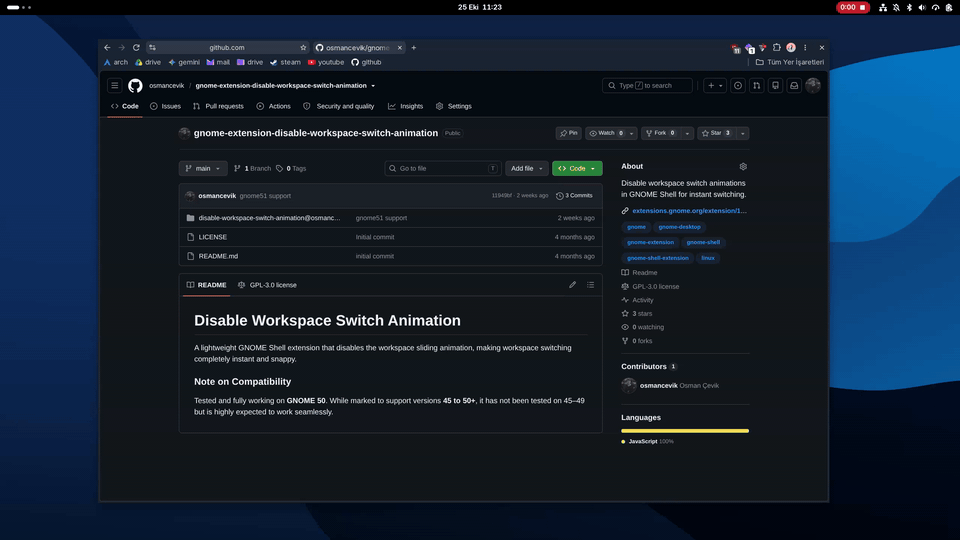

# Disable Workspace Switch Animation

A lightweight GNOME Shell extension that disables the workspace sliding animation, making workspace switching completely instant and snappy.

## Comparison

| Before | After | 
| :---: | :---: |
|  |  |

### Note on Compatibility

Tested and fully working on **GNOME 50+**. While marked to support versions **45 to 50+**, it has not been tested on 45–49 but is highly expected to work seamlessly.
